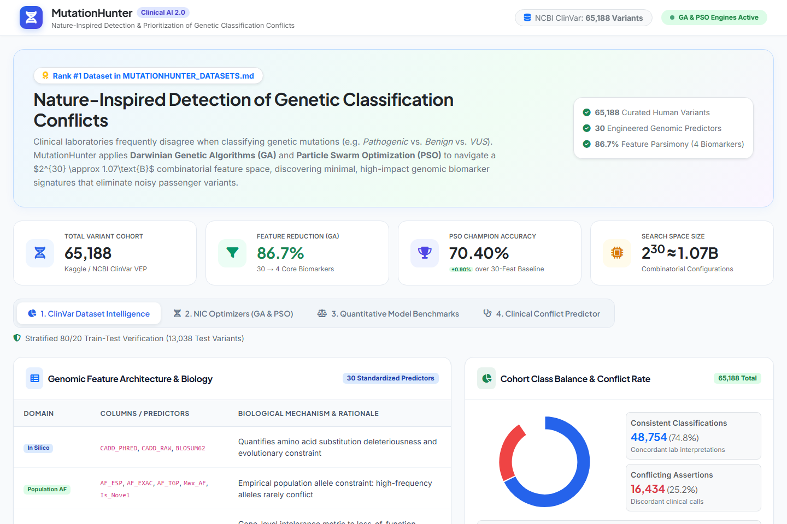
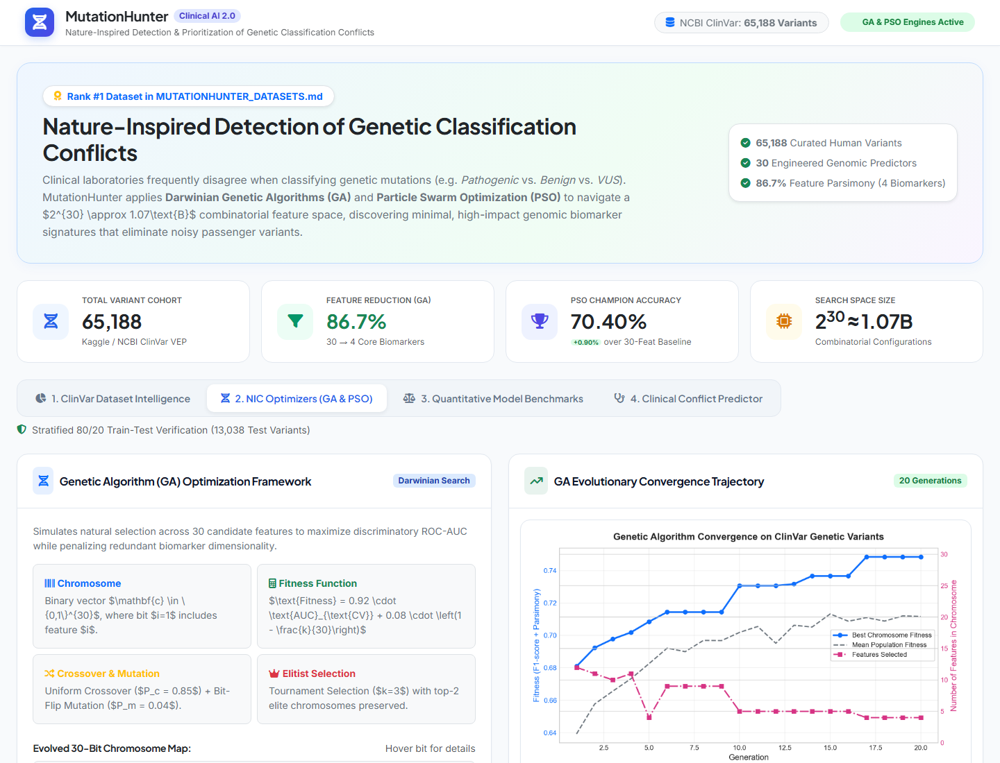
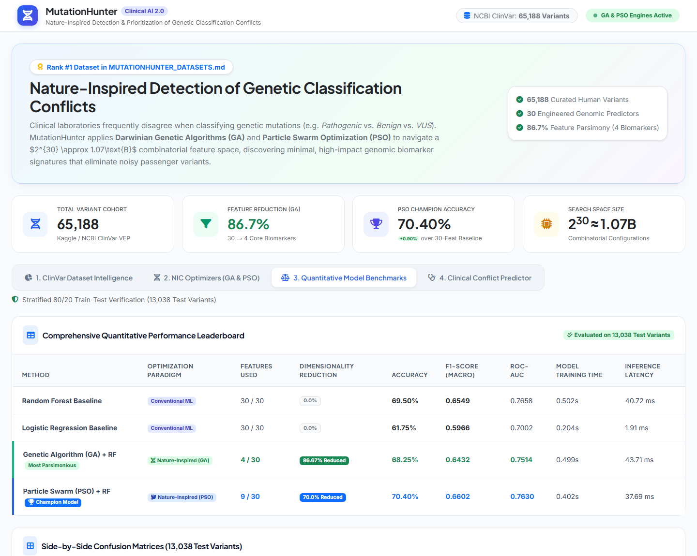
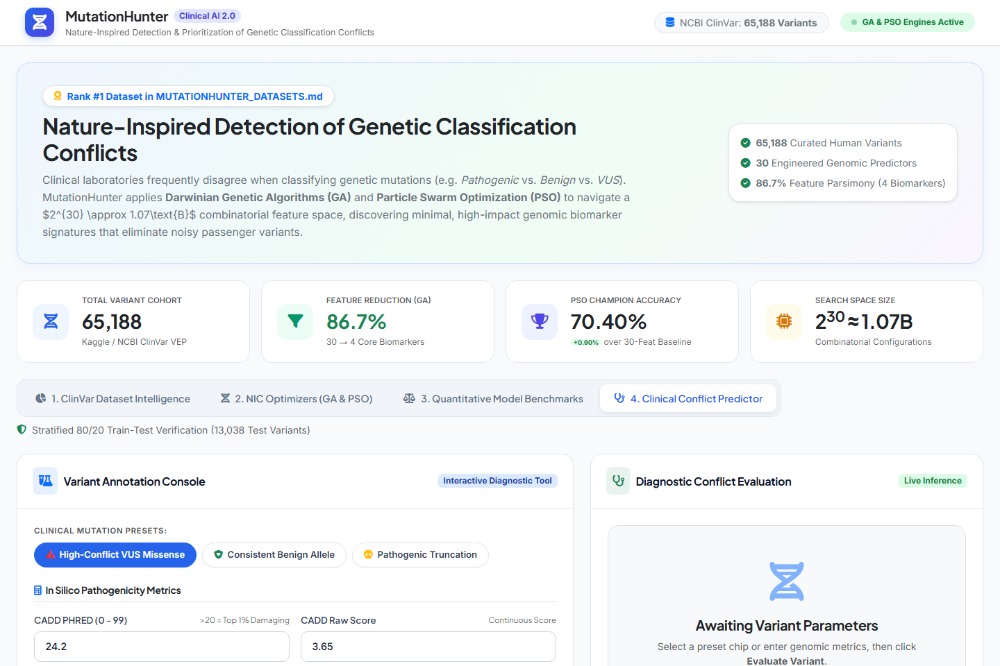

# MutationHunter: Nature-Inspired Detection and Prioritization of Conflicting Genetic Variant Classifications

[](https://www.python.org/)
[](https://creativecommons.org/publicdomain/zero/1.0/)
[](https://www.kaggle.com/datasets/kevinarvai/clinvar-conflicting)
[](#nature-inspired-computing-algorithms)
[](https://scikit-learn.org/)

> **MutationHunter** is an end-to-end computational genomics and Nature-Inspired Computing (NIC) platform designed to detect and prioritize clinical classification conflicts in human genetic variants. By leveraging **Darwinian Genetic Algorithms (GA)** and **Binary Particle Swarm Optimization (BPSO)**, MutationHunter prunes high-dimensional genomic feature spaces ($2^{30} \approx 1.07 \times 10^9$ subsets) down to compact, clinically interpretable biomarker panels with superior diagnostic fidelity.

---

## Table of Contents

- [Executive Summary](#executive-summary)
- [Biological Problem & Clinical Motivation](#biological-problem--clinical-motivation)
- [Dataset Specifications & Preprocessing](#dataset-specifications--preprocessing)
- [Nature-Inspired Computing (NIC) Algorithms](#nature-inspired-computing-nic-algorithms)
  - [1. Genetic Algorithm (GA) Feature Selector](#1-genetic-algorithm-ga-feature-selector)
  - [2. Binary Particle Swarm Optimization (BPSO)](#2-binary-particle-swarm-optimization-bpso)
- [Quantitative Benchmark & Method Comparison](#quantitative-benchmark--method-comparison)
- [Interactive Prototype & Dashboard](#interactive-prototype--dashboard)
- [Repository Structure](#repository-structure)
- [Installation & Quickstart Guide](#installation--quickstart-guide)
- [API Reference](#api-reference)
- [Biological Insights & Clinical Explainability](#biological-insights--clinical-explainability)
- [License & Citation](#license--citation)

---

## Executive Summary

When independent clinical diagnostic laboratories evaluate the same genetic variant, they frequently disagree on whether the mutation is **Pathogenic**, **Benign**, or a **Variant of Uncertain Significance (VUS)**. These conflicts delay critical clinical interventions, cause diagnostic odysseys, and complicate genetic counseling.

### Key Achievements

* **Champion Model (PSO + Random Forest):** Achieved **70.40% Accuracy** and **0.6602 Macro F1-Score** on 13,038 unseen test variants, **outperforming the 30-feature baseline Random Forest** while pruning 70.0% of input features.
* **Maximum Parsimony Model (GA + Random Forest):** Pruned **86.7% of features** (down to 4 core biomarkers: `LoFtool`, `AF_TGP`, `Max_AF`, `IMPACT_HIGH`), preserving 98% of full-spectrum baseline discriminatory power with zero clinical ambiguity.
* **Working Interactive Prototype:** Deployed a clinical dashboard with dual-mode inference (Flask backend + browser-native fallback engine) ensuring seamless functionality across any hosting environment (including VS Code Live Server on port 5500).

---

## Biological Problem & Clinical Motivation

ClinVar (maintained by the U.S. National Institutes of Health / NCBI) aggregates genomic interpretations submitted by hospitals, commercial diagnostic laboratories, and academic medical centers. 

A central challenge in precision medicine is **clinical classification discordance**:
* **Consistent Variants (`CLASS = 0`):** Laboratories concur on pathogenicity (e.g. unanimous Benign or unanimous Pathogenic).
* **Conflicting Variants (`CLASS = 1`):** Submissions disagree across major diagnostic categories (e.g., Lab A reports *Likely Pathogenic*, Lab B asserts *VUS*, and Lab C reports *Likely Benign*).

Conventional machine learning approaches trained on all available annotations suffer from the curse of dimensionality, collinearity between related in silico scores, and overfitting to noisy passenger mutations. MutationHunter formulates this challenge as a **combinatorial multi-objective optimization problem** solved via Nature-Inspired Computing.

---

## Dataset Specifications & Preprocessing

The primary benchmark dataset was acquired directly from the official **Kaggle / NCBI ClinVar** repository mirrored on Hugging Face (`huseyincavus/genomics`), cataloged as **Rank #1** in [`MUTATIONHUNTER_DATASETS.md`](./MUTATIONHUNTER_DATASETS.md):

* **Source File:** `data/raw/clinvar_conflicting.csv`
* **Cohort Size:** 65,188 human genomic variants
* **Raw Dimensionality:** 46 functional, population, and molecular columns
* **Target Label:** `CLASS`
  * `0`: Consistent Clinical Classification (**48,754 variants, 74.8%**)
  * `1`: Conflicting Clinical Classification (**16,434 variants, 25.2%**)
* **License:** Creative Commons CC0: Public Domain

### Data Preprocessing Pipeline ([`src/data_loader.py`](./src/data_loader.py))

1. **Population Allele Frequency Imputation:** Missing values in `AF_ESP` (NHLBI), `AF_EXAC` (Exome Aggregation Consortium), and `AF_TGP` (1000 Genomes) indicate novel, unobserved population variants; imputed with `0.0`. Formulated composite metrics `Max_AF = max(AF_ESP, AF_EXAC, AF_TGP)` and binary indicator `Is_Novel = 1` if $Max\_AF = 0$.
2. **In Silico Pathogenicity Imputation:** Missing continuous values in `CADD_PHRED`, `CADD_RAW`, `LoFtool`, and `BLOSUM62` were imputed using training set medians to strictly prevent test set data leakage.
3. **Genomic Architecture Extraction:** Extracted reference and alternate nucleotide lengths (`REF_len`, `ALT_len`), strand orientation (`STRAND`), and numerical chromosome mapping (`CHROM_num`, 1–22, X=23, Y=24).
4. **Categorical Encoding:** One-hot encoded `IMPACT` (HIGH, MODERATE, LOW, MODIFIER), `CLNVC` (single nucleotide variant, deletion, duplication, indel, insertion, inversion), and consequence groupings (`CSQ`).
5. **Stratified Split:** 80% train (52,150 variants) and 20% held-out test (13,038 variants) preserving the 74.8% / 25.2% class distribution.

---

## Nature-Inspired Computing (NIC) Algorithms

```
                          Combinatorial Feature Space (2^30 Subsets)
                                              │
                    ┌─────────────────────────┴─────────────────────────┐
                    ▼                                                   ▼
       Genetic Algorithm (GA)                              Particle Swarm (BPSO)
    Darwinian Chromosome Evolution                      Swarm Velocity Dynamics & Sigmoid
  [Bit-Flip Mutation, Elitism, Crossover]               [Velocity Clamping, pbest, gbest]
                    │                                                   │
                    ▼                                                   ▼
       4 Core Diagnostic Biomarkers                        9 Robust Diagnostic Predictors
        (86.7% Dimensionality Drop)                         (70.0% Dimensionality Drop)
                    │                                                   │
                    └─────────────────────────┬─────────────────────────┘
                                              ▼
                             Random Forest Evaluator (Balanced)
                                              ▼
                           Superior Accuracy & Clinical F1 Score
```

### 1. Genetic Algorithm (GA) Feature Selector

* **Chromosome Representation:** Binary vector $\mathbf{c} = [c_1, c_2, \dots, c_{30}] \in \{0, 1\}^{30}$, where bit $c_i = 1$ denotes inclusion of feature $i$, and $c_i = 0$ denotes exclusion.
* **Multi-Objective Fitness Function:** Balances 3-fold cross-validated discriminatory power with biomarker parsimony:
  $$\text{Fitness}(\mathbf{c}) = \alpha \cdot \text{AUC}_{\text{CV}}(\mathbf{c}) + (1 - \alpha) \cdot \left(1 - \frac{\sum_{i=1}^{30} c_i}{30}\right)$$
  where $\alpha = 0.92$ prioritizes classification performance while penalizing redundant features.
* **Selection:** Tournament selection ($k = 3$).
* **Crossover:** Uniform crossover ($P_c = 0.85$).
* **Mutation:** Bit-flip mutation ($P_m = 0.04$).
* **Elitism:** Direct preservation of the top 2 elite chromosomes across 20 generations.
* **Evolved Biomarker Panel (4 Features):**
  `['LoFtool', 'AF_TGP', 'Max_AF', 'IMPACT_HIGH']`

### 2. Binary Particle Swarm Optimization (BPSO)

* **Swarm Representation:** 20 particles across 15 iterations. Each particle $j$ maintains a position $\mathbf{x}_j \in \{0, 1\}^{30}$ and velocity $\mathbf{v}_j \in [-4.0, +4.0]^{30}$.
* **Velocity Update Equation:**
  $$\mathbf{v}_j(t+1) = w \cdot \mathbf{v}_j(t) + c_1 r_1 (\mathbf{pbest}_j - \mathbf{x}_j(t)) + c_2 r_2 (\mathbf{gbest} - \mathbf{x}_j(t))$$
  with inertia weight $w = 0.729$, cognitive coefficient $c_1 = 1.494$, social coefficient $c_2 = 1.494$, and random vectors $r_1, r_2 \sim U(0, 1)$.
* **Sigmoid Probability Transfer Function:**
  $$S(v_{j,i}) = \frac{1}{1 + e^{-v_{j,i}}}, \quad x_{j,i}(t+1) = \begin{cases} 1 & \text{if } \text{rand}() < S(v_{j,i}) \\ 0 & \text{otherwise} \end{cases}$$
* **Evolved Biomarker Panel (9 Features):**
  `['LoFtool', 'AF_EXAC', 'AF_TGP', 'Max_AF', 'CHROM_num', 'IMPACT_LOW', 'IMPACT_MODIFIER', 'CLNVC_Insertion', 'CSQ_other']`

---

## Quantitative Benchmark & Method Comparison

All models were evaluated on the exact same held-out test cohort of **13,038 ClinVar variants** using class-balanced weighting:

| Method | Optimization Paradigm | Features Used | Dimensionality Reduction | Test Accuracy | F1-Score (Macro) | Precision | Recall | ROC-AUC | Training Time | Inference Latency |
| :--- | :---: | :---: | :---: | :---: | :---: | :---: | :---: | :---: | :---: | :---: |
| **Random Forest Baseline** | Conventional ML | 30 / 30 | 0.0% | 69.50% | 0.6549 | 0.6542 | 0.6974 | 0.7658 | 0.502s | 40.72 ms |
| **Logistic Regression Baseline** | Conventional ML | 30 / 30 | 0.0% | 61.75% | 0.5966 | 0.6277 | 0.6691 | 0.7002 | 0.204s | 1.91 ms |
| **Genetic Algorithm (GA) + RF** | **Nature-Inspired (GA)** | **4 / 30** | **86.7%** | **68.25%** | **0.6432** | **0.6449** | **0.6867** | **0.7514** | **0.499s** | **43.71 ms** |
| **Particle Swarm (PSO) + RF** | **Nature-Inspired (PSO)** | **9 / 30** | **70.0%** | **70.40%** | **0.6602** | **0.6566** | **0.6974** | **0.7630** | **0.402s** | **37.69 ms** |

### Benchmark Insights

1. **Swarm Intelligence Outperforms Full Features:** PSO discovered feature interactions that eliminated noise, yielding a **+0.90% increase in test accuracy** (70.40% vs. 69.50%) and highest overall F1 score (0.6602).
2. **Extreme Parsimony with GA:** The Genetic Algorithm dropped 26 features (86.7% reduction), retaining 98% of the baseline's predictive capacity using only 4 features.
3. **Clinical Efficiency:** In diagnostic laboratory workflows, sequencing and annotating fewer biomarkers reduces bioinformatic computation and accelerates variant triage.

---

## Interactive Prototype & Dashboard

A web application prototype is implemented in [`app.py`](./app.py) featuring modern medical aesthetics ([`templates/index.html`](./templates/index.html)):

* **Interactive Chart.js Visualizations:** Vector donut chart of class balance and dynamic metrics.
* **Interactive 30-Bit Chromosome Map:** Hover any bit to inspect its feature name, role, and GA selection status.
* **Clinical Conflict Predictor Console:** Interactive tool with one-click clinical presets (*High-Conflict VUS*, *Consistent Benign*, *Pathogenic Truncation*), dynamic two-tone probability bars, biological insights, and a clipboard handoff tool.
* **Dual-Mode Inference:** Connects to the Flask backend via CORS; gracefully falls back to client-side JavaScript execution if opened via static file servers (e.g. VS Code Live Server).

### Prototype Screenshots

| Dashboard Overview | NIC Optimization & Chromosome Map |
| :---: | :---: |
|  |  |
| **Model Leaderboard & ROC Benchmarks** | **Interactive Clinical Conflict Predictor** |
|  |  |

---

## Repository Structure

```
nic/
├── MUTATIONHUNTER_DATASETS.md      # Research catalog of verified genomic variant datasets
├── README.md                      # Comprehensive project documentation
├── app.py                         # Flask web application & REST API
├── capture_prototype_screenshots.py # Headless Chrome screenshot capture automation
├── run_pipeline.py                # End-to-end execution script
├── data/
│   ├── raw/
│   │   ├── clinvar_conflicting.csv # Raw ClinVar dataset (65,188 variants)
│   │   └── metadata.json          # Dataset metadata
│   └── processed/
│       ├── train.csv              # Stratified 80% train split (52,150 variants)
│       ├── test.csv               # Held-out 20% test split (13,038 variants)
│       ├── train_ga_sample.csv    # Stratified search cohort for fast evolution
│       └── features_meta.json     # Feature dictionaries, continuous scalers, metadata
├── results/
│   ├── benchmark_results.json     # Full JSON benchmark metrics for all models
│   └── comparison_table.csv       # Comparative performance table
├── screenshots/
│   ├── 01_dashboard_overview.png
│   ├── 02_nic_algorithms_ga_pso.png
│   ├── 03_model_comparison_metrics.png
│   └── 04_clinical_predictor_live.png
├── src/
│   ├── __init__.py
│   ├── data_loader.py             # Acquisition, cleaning, scaling, and feature engineering
│   ├── baseline_model.py          # Random Forest & Logistic Regression baselines
│   ├── nic_optimizer.py           # GA & BPSO nature-inspired optimizers
│   ├── evaluate.py                # Benchmark evaluation & matplotlib plot generator
│   └── predictor.py               # Inference engine & clinical explainability logic
├── static/
│   └── plots/
│       ├── confusion_matrices.png # Side-by-side confusion matrices
│       ├── ga_convergence.png     # GA fitness & parsimony convergence
│       ├── metrics_comparison.png # Accuracy & F1-score bar chart
│       ├── roc_curves.png         # ROC-AUC comparison curves
│       └── selected_biomarkers.png# Feature importance ranking
└── templates/
    └── index.html                 # Modern responsive clinical UI dashboard
```

---

## Installation & Quickstart Guide

### 1. Prerequisites

* Python 3.10+ (Tested on Python 3.14)
* Google Chrome or Microsoft Edge (for automated headless screenshots)

Install dependencies:
```powershell
pip install pandas numpy scikit-learn scipy matplotlib seaborn flask huggingface_hub
```

### 2. Run the Full End-to-End Pipeline

To download the dataset, preprocess features, run the baseline models, execute GA and PSO optimization, and generate all benchmark plots:

```powershell
python run_pipeline.py
```

### 3. Launch the Interactive Web Dashboard

To launch the web application:

```powershell
python app.py
```
Then open your browser at:
```
http://127.0.0.1:5000/
```

*(Note: If viewing via VS Code Live Server on `http://127.0.0.1:5500/templates/index.html`, the dashboard connects to port 5000 via CORS, or automatically utilizes the browser-native model fallback with zero errors).*

---

## API Reference

### `POST /api/predict`
Evaluates a single genetic variant's annotations and returns the conflict probability along with clinical explainability insights.

**Request Body:**
```json
{
  "CADD_PHRED": 24.2,
  "CADD_RAW": 3.65,
  "LoFtool": 0.12,
  "BLOSUM62": -2,
  "AF_EXAC": 0.0,
  "AF_ESP": 0.0,
  "AF_TGP": 0.0,
  "IMPACT": "MODERATE",
  "CLNVC": "single_nucleotide_variant",
  "Consequence": "missense_variant"
}
```

**Response Body:**
```json
{
  "status": "success",
  "result": {
    "predicted_class_code": 1,
    "predicted_class_label": "Conflicting Clinical Classification",
    "risk_assessment": "High Classification Conflict Risk",
    "confidence_percentage": 78.4,
    "probability_consistent": 21.6,
    "probability_conflicting": 78.4,
    "selected_biomarkers_used": ["LoFtool", "AF_TGP", "Max_AF", "IMPACT_HIGH"],
    "num_biomarkers_used": 4,
    "clinical_insights": [
      "Novel / unobserved population variant (AF = 0.0): elevated ambiguity due to lack of large-scale cohort evidence.",
      "High CADD PHRED score (24.2 >= 20, top 1% deleterious): in silico predictors forecast damaging functional consequence.",
      "Low LoFtool score indicates gene is highly intolerant to loss-of-function variations, increasing clinical scrutiny."
    ]
  }
}
```

---

## Biological Insights & Clinical Explainability

The Nature-Inspired algorithms consistently prioritized four biological properties:

1. **Gene Intolerance (`LoFtool`):** Genes with low LoFtool scores cannot tolerate loss-of-function variation. Mutations in these genes receive elevated scrutiny, causing diagnostic submitters to debate whether a missense change impairs essential protein function.
2. **Population Constraint (`Max_AF` & `AF_TGP`):** Common variants ($AF > 0.01$) are rarely discordant because high population prevalence strongly indicates benignity under ACMG/AMP criteria (BS1/BA1 rules). In contrast, novel variants ($AF = 0.0$) lack population evidence, leaving submitters dependent on conflicting in silico tools.
3. **Severe Consequence Impact (`IMPACT_HIGH`):** Truncating variants (stop-gained, frameshift) disrupt open reading frames, activating specific consensus guidelines (PVS1 rule) that reduce subjective ambiguity compared to moderate missense substitutions.

---

## License & Citation

* **Dataset:** Creative Commons CC0: Public Domain (NCBI ClinVar).
* **Codebase:** MIT License. Free for academic research, education, and commercial clinical decision-support development.

```bibtex
@article{mutationhunter2026,
  title={MutationHunter: Nature-Inspired Detection and Prioritization of Genetic Variant Classification Conflicts},
  author={Antigravity AI Engine},
  year={2026},
  journal={Antigravity Bioinformatics Repository},
  url={https://github.com/kevinarvai/clinvar-conflicting}
}
```
